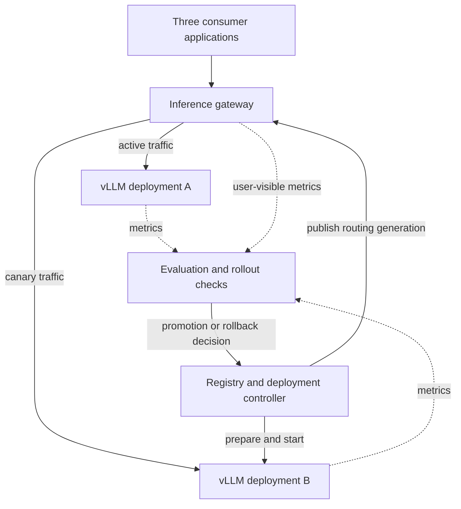
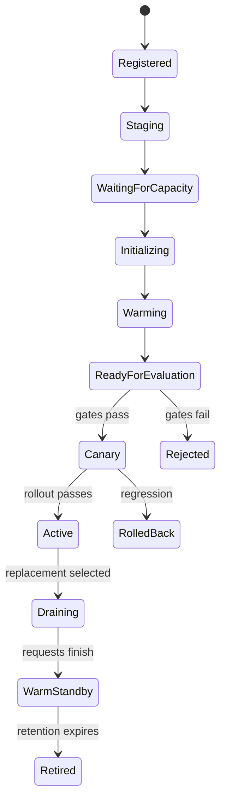
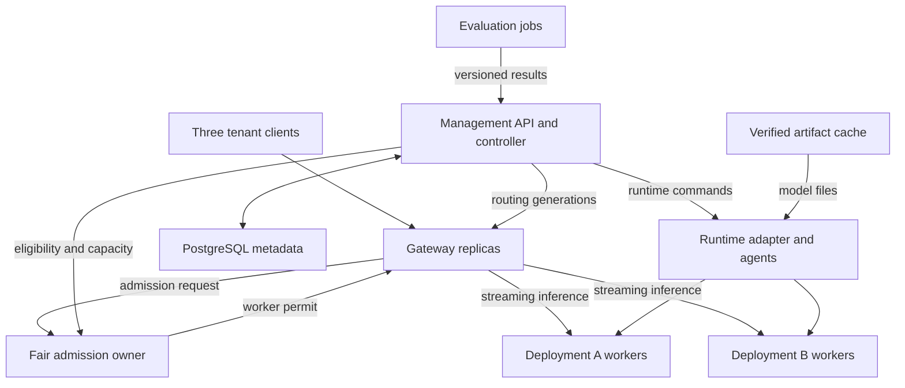

**ModelFleet — Multi-Team LLM Serving and Safe Model Rollouts**

Architecture proposal and implementation backlog • October 1, 2026

Build a small shared inference platform whose consumer applications keep a stable API while models and runtime configurations change behind it. Reproduce the model release lifecycle with two small model versions before exploring large models. The four teams below represent ownership areas, suitable for a small group or for one person implementing the modules sequentially.

The target is measured service continuity and controlled performance/quality risk during upgrades. A bigger model does not automatically meet the old model's latency or cost. This document proposes a system; it does not claim an implemented deployment or measured results.

**1. Scope and the demonstration**

Use three thin clients of a shared gateway: document assistance, text summarization, and report drafting. Existing PlantOps workflows could become clients later. Begin with bounded text prompts and known reference outputs so evaluation stays manageable.

Demonstrate this sequence under continuous traffic:

1. Deployment A is active behind the alias `assistant-default`.
2. Register model B as an immutable candidate with a pinned model revision and runtime configuration.
3. Download/stage its artifacts, reserve capacity, and initialize a separate inference worker. A continues serving.
4. Warm B, test protocol compatibility, and evaluate representative latency and quality.
5. Route a small fraction of eligible new requests to B, increasing only when gates pass.
6. Show both a successful promotion and an intentionally unhealthy candidate that triggers rollback.
7. Drain requests from the replaced deployment and retain a warm previous version for a defined rollback window, if the capacity budget permits it.

The demo should also show insufficient GPU capacity blocking deployment rather than stopping A to make room.

**2. Production references and their limits**

Uber describes a shared GenAI Gateway that gives multiple teams a consistent interface and centralized usage controls. This supports the gateway boundary and tenant-aware policies here, without implying that this project reproduces Uber's internals. [Uber gateway](https://www.uber.com/us/en/blog/genai-gateway/)

Ray documents initialization work beyond downloading weights, including engine preparation and warmup. Measure these stages separately. [Ray initialization](https://github.com/ray-project/ray/blob/master/doc/source/serve/llm/user-guides/deployment-initialization.md)

KServe documents side-by-side LLM versions and weighted traffic splitting. Its exact configuration and gateway behavior are version-dependent; the initial custom gateway below implements a small, explicit release workflow. [KServe canary rollouts](https://kserve.github.io/website/docs/model-serving/generative-inference/llmisvc/canary-rollout)

The proposed contracts, thresholds, and ownership map below are recommendations for this project, not universal company practices.

**3. Four ownership areas**

| Owner | Modules | Deliverable | Contract with the other owners |
| --- | --- | --- | --- |
| Applications | clients/, consumer examples | Three independent clients with different workload profiles | Stable inference API, alias, quotas, and evaluation examples |
| Model onboarding | catalog/, manifests/, artifact staging | Immutable candidate descriptions and verified artifacts | Model revision, tokenizer/template, runtime image, capabilities, resource request |
| Serving/platform | gateway/, runtime adapter, capacity manager | Streaming requests, admission, readiness-aware routing, deployment lifecycle | Deployment ID, observed state, runtime endpoint, capacity reservation |
| Quality/reliability | evaluation/, rollout policy, telemetry | Offline gates, canary analysis, rollback decisions, experiment report | Versioned evaluation results and rollout policy decisions |

Keep these boundaries in one repository. They need not be four separate microservices. The initial deployment has a gateway, a control-plane service/controller, and inference workers, plus PostgreSQL and monitoring.

**4. Two paths through the system**

The request path handles user traffic. The management path registers and deploys models. Keep management work outside the request's critical path.

PostgreSQL stores models, deployment requests, observed states, route generations, policies, evaluations, and release events. A persistent artifact cache stores model files. Prometheus/Grafana display runtime and application metrics; detailed benchmark/evaluation results are saved separately.

Suggested stack: Go for the streaming gateway; Python/FastAPI for registration, artifact staging, evaluation, and controller logic; vLLM for inference; PostgreSQL for durable metadata; Docker Compose initially. Go provides backend experience and an explicit language boundary, not an inference speed guarantee. An all-Python version is valid if minimizing scope matters more.

**5. Model registration contract**

A model record must identify more than a friendly name:

| Field | Purpose |
| --- | --- |
| model_record_id | Immutable catalog identity |
| repository + revision | Exact weights source |
| artifact_manifest/checksums | Detect incomplete or mismatched files |
| tokenizer and chat-template revision | Reproduce input serialization |
| runtime image digest + engine settings | Reproduce the serving environment |
| context limit + generation defaults | Define what requests are accepted |
| supported capabilities | Chat/streaming/structured output supported by this deployment |
| precision/quantization | Explain memory and compatibility requirements |
| GPU/resource request | Reserve space before initialization |
| evaluation suite/version | Identify quality and performance evidence |

Changing the model, tokenizer, runtime, or materially relevant configuration creates a new candidate fingerprint. Preserve manifests and results so an old release can be reproduced. Use an allowlisted runtime and supported model format for the prototype.

An alias maps a consumer's requested model name to approved deployments. Different teams can have different rollout policies: the summarization client may accept a candidate while a structured-report client remains on A.

**6. Candidate lifecycle**

Separate deployment lifecycle from routing membership. READY means a worker can be tested, not that it is automatically production-approved.

A stage can fail or time out; store a diagnostic event and leave current production routing unchanged. Keep desired and observed state so the controller can resume after a restart. Use idempotent operations, deployment IDs, and controller leases/fencing to avoid launching duplicates or publishing stale routing decisions.

**7. Startup and readiness**

Instrument scheduling, artifact staging, process initialization, loading, runtime preparation, representative warmup, and end-to-end readiness separately.

Pre-stage model artifacts and container images. Keep a persistent weights cache and, where supported and compatible, a compile cache. A disk cache avoids repeated transfer; it does not imply that weights are already loaded into GPU memory or that every warmup step disappears. vLLM documents separate persistence for model and compile caches. [vLLM Docker deployment](https://docs.vllm.ai/en/latest/deployment/docker/)

A readiness gate must check the expected deployment identity, supported request format, and successful bounded generation. Warm representative short/long inputs and output formats. Exercise the gateway-to-candidate path explicitly before public eligibility; an open port or process health signal alone is inadequate.

If Kubernetes is added, give long initialization a startup probe budget and use readiness to control eligibility for traffic. Startup/liveness/readiness are different checks. [Kubernetes probes](https://kubernetes.io/docs/tasks/configure-pod-container/configure-liveness-readiness-startup-probes/)

Limit download, disk, CPU, and network concurrency too: staging B on the same host can affect A even if inference uses separate GPUs. Measure incumbent performance during every startup phase.

**8. Capacity: the necessary physical constraint**

Side-by-side rollout needs room for both serving environments: model weights, KV cache, runtime workspaces, and safe headroom. Reserve capacity before starting B. If unavailable, keep B in WAITING_FOR_CAPACITY with a visible reason.

| Available hardware | What can honestly be demonstrated |
| --- | --- |
| No GPU | Simulated initialization, weighted routing, quotas, gate logic, rollback and controller recovery |
| One GPU that fits two small workers | Real dual-model lifecycle, with shared-GPU interference explicitly measured |
| One GPU that fits only A | Staging and evaluation sequentially; continuous real-model side-by-side rollout is not supported |
| Separate capacity for A and B | Better startup/workload isolation and a real continuity experiment; shared host/network/storage may still contend |
| Multiple GPUs per large model | Apply the same lifecycle to an entire model replica/pool; more resource and networking work |

Two vLLM processes each attempting to reserve most of the same GPU's memory can conflict. Set explicit budgets and test peak behavior. Separate containers are not GPU compute isolation.

An example large model with 70 billion parameters and two bytes per parameter has roughly 140 GB of raw weights before cache and runtime allocations. Additional hardware, supported quantization, smaller context, or a different model may be needed. A rollout policy cannot make that physical requirement disappear.

**9. Gateway behavior and API stability**

Expose a bounded compatible chat/streaming API. Consumers send a stable alias such as `assistant-default`, not a deployment URL. The gateway resolves the alias, rewrites it to the worker's served model identifier where needed, and returns deployment/routing identity in metadata for debugging.

Gateway responsibilities:

- Authenticate callers and derive team identity server-side.
- Enforce allowed aliases, context/output limits, team quotas, bounded queues, and timeouts.
- Select an approved ready deployment using a versioned route snapshot.
- Stream tokens with cancellation propagation and record user-visible latency.
- Use session-based stable canary assignment for conversations; pin an entire multi-step report job to one deployment if it makes multiple calls.
- Remove unhealthy endpoints from eligibility. Only use an explicitly approved compatible fallback, and only before streaming has begun.

Never switch model versions in the middle of a response. After partial output, report interruption rather than silently replaying the request. Keep source/target deployment IDs in request records.

Cache the last good route snapshot in the gateway. Serving should continue if the management service is temporarily unavailable. Route changes have monotonic generations and atomic local replacement. Measure publication-to-application delay; do not assume every gateway applies a change simultaneously.

**10. Evaluation and release policy**

Before canary, check input/output compatibility and quality on versioned held-out examples from each affected consumer. Measure expected full-load capacity before promotion: a candidate receiving 5% traffic can look healthy simply because it is lightly loaded.

Suggested progressive steps are 5%, 25%, 50%, and 100% of eligible new sessions. These are configurable project choices. Require a minimum sample count and observation interval, not elapsed time alone. Insufficient or missing telemetry pauses promotion. Use sustained windows/hysteresis so isolated slow requests do not cause rapid oscillation.

Define gates before testing:

| Gate | Evidence |
| --- | --- |
| Protocol compatibility | Streaming, schema, tokenizer/context acceptance, cancellation |
| Quality | Task success, supported facts, schema and numeric checks where relevant |
| Latency | p95 first-token/end-to-end delay by workload class and request length |
| Reliability | Error, interruption, rejection and timeout rates |
| Capacity | Accepted work under the expected traffic level |
| Cost | Billed resource time and useful completed work |

An illustrative policy might allow at most a 10% p95 increase with no unacceptable quality change. If the desired requirement is no allowed slowdown, set a stricter gate and reject candidates that fail it. These are policy choices, not industry constants or performance promises.

Compare identical task examples and controlled input/output lengths, recording actual generation lengths. Tokenizers and early termination can make raw tokens/second misleading across different models. Preserve per-team metrics because an aggregate can hide a regression in one client.

Sampled shadow traffic can compare A and B without exposing B's output to users, but it consumes extra inference capacity. Start with offline replay; add shadowing only when resources permit it.

**11. Rollback and draining**

On sustained regression, publish a new routing generation returning new eligible traffic to A and set B's public traffic weight to zero. Keep existing streams on their selected deployment while they complete, with a bounded drain deadline.

Retain A ready and with enough capacity to accept the full workload during the rollback window. A catalog entry, cached weights on disk, or stopped worker cannot provide immediate rollback on its own. Warm standby spends GPU resources; cold rollback requires measured restart time.

Promotion to B and retirement of A are separate steps. After the retention window and successful full-load operation, drain A and release its resources. Preserve its manifest and cached artifacts as permitted by the storage budget.

Routing rollback changes new admissions; it does not repair answers already delivered or seamlessly move in-flight KV state to a different model.

**12. Management interfaces and durable records**

| API | Meaning |
| --- | --- |
| POST /models | Register immutable candidate metadata |
| POST /deployments | Request staging and initialization |
| GET /deployments/{id} | Read desired/observed state, stage timings, capacity/errors |
| POST /evaluations | Run a versioned compatibility/quality/performance suite |
| POST /rollouts | Start a policy for alias and affected team(s) |
| POST /rollouts/{id}/rollback | Publish the approved previous route |
| GET /rollouts/{id}/events | Read the audit trail and gate evidence |
| POST /v1/chat/completions | Consumer inference through the gateway |

Use PostgreSQL records for models, deployments, reservations, evaluations, route generations, rollout policies, controller jobs, and audit events. Management mutations are idempotent. Route publication uses a conditional update/version check so competing promotions cannot overwrite each other.

The runtime adapter exposes prepare/start/probe/drain/stop operations. Use a simulated adapter first, then a development Docker adapter. If later switching to Ray Serve or KServe, adapt these management calls rather than mixing competing controllers for the same worker.

**13. Implementation milestones and group collaboration**

| Milestone | Work | Acceptance demonstration |
| --- | --- | --- |
| 1. Stable contracts | Manifests, alias schema, API contracts, simulated A/B workers | All three clients call one gateway |
| 2. Controller | Durable desired/observed state, capacity reservations, stage events | Candidate waits for capacity; restart resumes correctly |
| 3. Real inference | One small vLLM model, then two versions if capacity allows | Existing requests continue while candidate initializes |
| 4. Gates | Held-out fixtures, controlled replay, metrics, readiness | Incompatible or slow candidate never becomes public |
| 5. Progressive rollout | Weighted/session routing, promotion, retained standby, rollback | Deliberate regression restores new traffic to A |
| 6. Reproducibility | Startup-cache experiments, failure matrix, documentation/demo | Another developer can repeat the experiment |

Within a small group, agree on the schemas first so application, gateway, registry/controller, and evaluation work can proceed independently against test doubles. Each integration test verifies a boundary: registry identity to runtime, readiness to routing, evaluation evidence to promotion, and consumer output to rollout identity.

One owner can implement all areas sequentially. Describe ownership honestly on a resume; four module boundaries do not establish collaboration with four actual teams.

**14. Meaningful experiments and failure cases**

Run the same offered workload through initial startup, background staging, warmup, canary, promotion, and rollback. Save raw request outcomes and deployment events with timestamps.

- Cold artifacts versus cached artifacts; cached weights versus compatible compile-cache reuse.
- Shared-GPU versus separate-capacity startup where hardware permits.
- Noisy bulk client alongside short interactive traffic; quota/admission enforcement by team.
- Candidate loading failure or incomplete artifacts; current routing remains valid.
- Candidate latency or structured-output regression; gate rejection or canary rollback.
- Controller restart during initialization/promotion; no duplicated serving deployment or stale route write.
- Gateway route refresh interruption; last good configuration continues, with health checks still enforced.
- Retirement with long streams; drain preserves completion until its documented deadline.

Measure startup-to-ready time, individual stage durations, incumbent p95 latency during candidate startup, per-team TTFT and completed work, error/rejection rates, route propagation delay, rollback time, and total resource cost. Simulated results verify orchestration only; label real GPU benchmarks separately.

**15. Further reading and later extensions**

NVIDIA describes weight streaming and initialized-state reuse to reduce fleet startup work. These depend on runtime and hardware support; they are research references after basic caching and warmup measurements. [Dynamo startup](https://developer.nvidia.com/blog/nvidia-dynamo-1-production-ready/)

Possible later work: Kubernetes probes and GPU scheduling, Ray Serve/KServe integration, compatible quantization, larger-model tensor parallelism, autoscaling with warm capacity, or cache-aware routing. Add one extension at a time after the release demo works.

**First build:** one gateway, two simulated inference workers, an immutable candidate manifest, and a routing policy. Make delayed readiness and rollback visible under continuous load. Replace the simulated workers with small vLLM deployments once the hardware budget is known.

**16. Concrete implementation architecture — October 2 expansion**

This expansion gives component boundaries, contracts, and a sequential implementation plan. It refines the earlier milestones, especially fair admission and the transition from one gateway to several. All modules and tests below are proposed work; the project has not been implemented or benchmarked.

Target one region, three tenants, two model deployments, and bounded text generation. Begin with independent model workers distributed across processes, then hosts. Tensor-parallel execution of one large model is a later runtime integration.

Keep three identities distinct: a model record is an immutable artifact/runtime fingerprint; a deployment is an instance of that fingerprint with a resource policy; a worker is one running replica of a deployment. A public alias maps a team to approved deployments. Example: assistant-default routes to deployment A or deployment B; A can eventually have workers A1 and A2. A restart creates a new worker incarnation, which prevents delayed commands or health reports from applying to its replacement.

The admission arrow carries request metadata and a permit, not the response stream. The gateway streams directly from the chosen worker. Initially the fair admission owner is a module in the only gateway. Before enabling several gateway replicas, extract it into one logical admission owner per worker pool. This adds a coordination hop and a failure dependency but prevents each gateway from granting the entire pool budget independently. A later partitioned-budget design can improve availability with explicitly measured fairness/utilization limits.

**17. Modules to implement and their authority**

| Proposed directory | Implementation | Responsibility and boundary |
| --- | --- | --- |
| gateway/ | Go | Authentication, alias resolution, request validation, streaming, deadlines, cancellation, local route snapshots |
| admission/ | Go package, later service | Per-tenant bounded queues, eligibility-aware fair dispatch, tenant and worker permits; no model loading or release approval |
| control/ | Python/FastAPI plus controller loop | Management APIs, durable intent, deployment reconciliation, alias rollout ownership, route publication |
| control/catalog/ | Python module | Immutable manifests and fingerprint verification |
| control/capacity/ | Python module | Placement and reservations; never interpret a lost heartbeat as proof that GPU memory is free |
| runtime/ | Python adapter and host agent | Idempotent prepare/start/probe/drain/stop, stable deployment/worker identities, resource fencing |
| evaluation/ | Python jobs | Versioned consumer fixtures, protocol and quality checks, replay/load experiments; results are evidence, not direct routing writes |
| workers/mock/ | Go test worker | Bounded SSE output, configurable startup delay, failure injection, worker identity |
| clients/ | Thin scripts | Interactive, bulk-summary, and report-generation workload profiles |
| deploy/ | Docker Compose, later Kubernetes manifests | Reproducible environment, resource configuration, persistent volumes |
| observability/ | Prometheus/Grafana configuration | Request, queue, worker, deployment, and release measurements |
| tests/ and docs/ | Integration harness and decisions | Failure scenarios, reproducible experiments, documented limitations |

Use one repository. The control modules can run in one service. Begin with HTTP/JSON internally and SSE for streaming. Introduce gRPC only if a measured requirement justifies it. A runtime adapter is the integration boundary: use a mock adapter, then Docker agents, then a Kubernetes adapter. Keep one authority for any given worker lifecycle. If adopting Ray Serve or KServe later, delegate worker orchestration through that adapter.

**18. First API contracts**

| Interface | Essential contract |
| --- | --- |
| POST /v1/chat/completions | Bounded compatible subset: alias, messages, output limit, stream flag; team identity comes from authentication |
| POST /models | Pinned source revision or verified artifact manifest, supported runtime settings, capabilities, context limits |
| POST /deployments | Model record and replica/resource request, plus an idempotency key; return an operation/deployment ID without waiting for initialization |
| GET /deployments/{id} | Desired state, observed stage, worker identities, reservation, timings and failure reason |
| POST /evaluations | Deployment fingerprint, fixture version, workload profile and policy revision |
| POST /rollouts | Team/alias, incumbent, candidate, expected routing generation, rollout policy |
| POST /rollouts/{id}/rollback | Idempotent transition that creates a newer routing generation and invalidates pending promotion work |
| GET /routes | Approved deployment membership, weights, capabilities, policy revision and generation; exclude raw artifact content |
| Internal admission acquire/release/cancel | Request ID, tenant, pinned deployment, deadline, bounded cost estimate; returns permit ID and worker incarnation |
| Internal runtime operations | Deployment ID, worker incarnation, manifest fingerprint, operation ID and fencing epoch |

Adopt separate deployment and rollout state machines. Deployment stages describe artifacts and runtime readiness. Rollout stages describe evaluation, canary, promotion, cancellation and rollback. A ready worker can have zero public eligibility. Keep observed health separate because readiness can change after approval.

**19. Request execution and fairness**

Authenticate and validate before queueing. Resolve an approved deployment from the current routing generation and bind the request to that deployment. The admission owner queues metadata by deployment and tenant, then chooses an eligible tenant request and a worker with an available permit. The gateway proxies the request and streams its output. A healthy terminal response returns the permit. Cancellation propagates to the worker; uncertain execution stays charged until runtime observation establishes that it ended.

Initially, one gateway owns all queues and permits in memory. Queue overflow produces an explicit rejection; queued work has a deadline. If that gateway restarts, pending connections fail visibly rather than promising durable inference. Deployment jobs are durable; interactive inference requests are not durable jobs in this version.

Start with round-robin admission and equal, bounded workloads. Add per-tenant active limits so long-running requests cannot occupy every worker slot. Then compare heterogeneous request sizes and optionally adopt deficit round robin with estimated token-work charges and reconciliation against observed usage. Request counts and GPU work are different measures. Fair admission does not enforce token-level fairness inside vLLM.

Before extracting admission into a replicated service, define a single logical owner per pool, fenced worker permits, and failover reconciliation. A new owner must reconstruct or conservatively retain active occupancy. Forgetting active requests or releasing permits solely on TTL expiry can oversubscribe the worker. Runtime-side enforcement is necessary for a hard bound. Admission unavailability blocks new work for that pool; already-running streams can continue directly between gateway and worker.

Deployment starvation needs a different policy: reserve startup/rollout headroom, limit artifact-transfer and initialization concurrency, and age feasible jobs. A model that cannot fit is explicitly unschedulable; increasing its priority cannot create memory. Define progress claims only for admitted, feasible work with bounded execution and available resources.

**20. Onboarding while serving and recovery**

Register immutable metadata, then stage files into a temporary location. Publish a cache entry only after integrity verification. Use a single staging writer per artifact entry or a conditional publication operation. Avoid overwriting files used by the incumbent.

Persist desired deployment state and an operation identity before external effects. Reserve capacity, then ask the runtime adapter to ensure a worker exists. On an ambiguous response, inspect the named worker and its incarnation before retrying. Reconciliation adopts matching existing work or records a conflict. A runtime timeout is not proof that worker creation failed.

Warm the candidate through the actual gateway protocol, verify its fingerprint and capabilities, and record evaluation evidence. Promotion checks the current rollout revision and eligibility. Production route decisions serialize per team/alias; staging unrelated candidates may proceed concurrently. Delayed evaluations, stale controller owners, duplicate commands and older route events cannot override newer decisions.

Store metadata changes and outbox event intent together. Delivery may repeat; apply events by identity/generation and periodically resynchronize from authoritative state. The gateway swaps a complete immutable route snapshot locally. Promotion and rollback propagate asynchronously, and publication-to-application delay is measured.

On rollback, revoke candidate admission and publish newer routing. Recheck eligibility when dispatching queued work; reject cancelled candidate work or explicitly rebind it before execution under the fallback policy. Do not move an executing stream to another model. Retain A until serving gateways/admission owners have acknowledged revocation of old membership and active work drains. In the initial version, an unreachable serving gateway prevents retirement; enforced expiration/fencing is a later extension.

**21. Infrastructure and explicit tradeoffs**

Use Docker Compose for one gateway, mock workers, the controller, PostgreSQL, a persistent artifact volume and monitoring. Containers on one host validate protocol and recovery logic; they do not demonstrate host independence. Add real small vLLM workers when hardware is known, then place runtime agents on two hosts. Finally add Kubernetes for placement, probes and process lifecycle; application-level rollout policy and fairness remain explicit platform responsibilities.

PostgreSQL is the authority for management state. Initially it is a documented single point of failure: its outage pauses management while cached approved serving may continue. Production-grade HA and failover semantics require a separate design. Do not independently invent consensus in each service.

Choose an extra admission hop for coordinated fairness across gateways, cached routing for low request-path overhead, and warm standby for low rollback restart delay. Each has a cost: admission availability/latency, routing staleness, and retained GPU use respectively. A bigger model may require more resources or have worse intrinsic latency; quality/performance gates decide whether it qualifies.

Store artifacts on a persistent volume first. Add object storage when several hosts need shared distribution. Use pinned model revisions first, then direct uploads of supported formats with the same manifest and verification contract. Bind serving operations to allowlisted runtime images and approved model capabilities.

**22. Sequential implementation backlog**

| Commit-sized milestone | Work | Acceptance evidence |
| --- | --- | --- |
| 1. Contracts and mock worker | Define request/identity schemas; mock health and bounded SSE streams; startup-delay and failure controls | Worker A/B responses identify the selected deployment and incarnation |
| 2. Single gateway | Alias snapshot, worker selection, SSE proxy, deadlines and cancellation | Two clients stream concurrently; route changes affect only subsequent admissions |
| 3. Fair bounded admission | Per-tenant queues, round-robin, active permits, limits and cancellation cleanup | A flooding tenant does not indefinitely postpone accepted eligible work from another tenant under the stated workload |
| 4. Durable management | Catalog, operation IDs, desired/observed records, reservation and mock runtime adapter | New candidate waits for readiness/capacity while incumbent continues; duplicate submission returns existing work |
| 5. Release workflow | Consumer fixtures, offline checks, canary membership, promotion, rollback and draining | Failing candidate is blocked; rollback invalidates delayed promotion; long streams follow the drain deadline |
| 6. Concurrent controllers | Scoped ownership, fencing, reconciliation, outbox and resynchronization | Pause an old controller, replace its ownership, reject stale commands; recover after worker creation without duplicate serving workers |
| 7. Real engine | Integrate small supported vLLM model(s), artifact cache, measured warmup | Separate real startup and inference results from simulation results |
| 8. Several gateways | Extract admission owner, implement worker-enforced permits and occupancy reconciliation | Total admission stays within pool budget; gateway replicas do not multiply quotas |
| 9. Several hosts | Remote agents, membership/incarnation checks, ambiguous host failure handling | Remove unreachable endpoints; retain uncertain reservations; recover/reconcile rejoining hosts |
| 10. Repeatable experiment | Offered-load generator, failure script, dashboards and concise technical report | Another developer reproduces model onboarding, fair admission, rollback and controller recovery |

**23. Definition of a finished project and reading map**

The final demonstration combines continuous three-tenant traffic, slow candidate initialization, competing rollout intent, a controller restart, a deliberately unhealthy candidate, rollback, draining and resource cleanup. Record per-tenant queue wait and maximum wait, rejection/timeout rates, accepted/completed work, first-token and end-to-end latency, incumbent degradation during startup, route propagation delay, stage timings and resource usage. Maximum observed wait is evidence for that experiment, not a proof for unlimited traffic or arbitrary failures.

Use deterministic barriers for concurrency tests rather than hoping random timing reproduces races. Test a crash after runtime creation but before acknowledgement, a late gate result after rollback, an older routing event after a newer one, a watch/discovery interruption, cancellation during queueing and execution, a disconnected host and a gateway holding old routing. Use the Go race detector for in-process sharing; use integration tests for cross-process ordering and failures.

Implementation references:

- [vLLM online serving](https://docs.vllm.ai/en/latest/serving/online_serving/) — engine/API integration boundary.
- [Kubernetes controller pattern](https://kubernetes.io/docs/concepts/architecture/controller/) — desired/observed state and reconciliation.
- [KServe LLM canary workflow](https://kserve.github.io/website/docs/model-serving/generative-inference/llmisvc/canary-rollout) — versioned deployment groups and weighted routing.
- [Ray Serve LLM architecture](https://docs.ray.io/en/latest/serve/llm/architecture/overview.html) — ingress, model servers and replicas.
- [vLLM Production Stack](https://github.com/vllm-project/production-stack) — router, aliases, discovery and metrics.
- [Original deficit round robin paper](https://openscholarship.wustl.edu/cgi/viewcontent.cgi?article=1339&context=cse_research) — later cost-aware admission extension.

Immediate work is milestones 1 and 2: a streaming worker and gateway with stable identity, bounded requests, cancellation and a testable routing snapshot. Milestone 3 adds fairness. GPU deployment is a later stage, so learning and correctness work can begin without downloading a large model.

**24. Security architecture and threat model — October 2 expansion**

Security is part of the API, deployment workflow and resource policy from the first milestone. This is a proposed threat model and implementation backlog, not a security certification or a claim that the controls have been implemented.

Protect tenant prompts and outputs, private model artifacts, release authority, GPU capacity, service credentials and deployment history. Treat tenant requests, submitted manifests and uploaded files as untrusted. The prototype trusts cluster operators and approved runtime code. Supporting adversarial arbitrary model code requires stronger isolation and a separate operating model; do not imply that container hardening establishes that guarantee.

Three boundaries define the design: public inference traffic enters a restricted gateway; deployment actions enter an authenticated management API with separate permissions; artifacts enter quarantine and validation before runtime staging. vLLM workers, admission endpoints, runtime agents, database, cache and monitoring remain private.

| Threat | Enforcement owner | Required behavior |
| --- | --- | --- |
| Forged identity or cross-tenant object access | Gateway and management API | Verify identity; derive tenant server-side; authorize every model, deployment, route and audit query |
| Consumer attempts production promotion | Management policy | Separate inference, artifact submission, release and operator permissions |
| Uploaded executable or unsupported model | Artifact validator and runtime policy | Restricted formats/architectures, approved runtime images, no uploader-controlled executable configuration |
| Model URL targets internal services | Download worker and egress policy | Approved source contract, destination checks, redirect controls and restricted outbound traffic |
| Cost/availability abuse | Edge, gateway, admission and capacity manager | Bound payloads, token work, streams, queues, staging bytes and deployment concurrency |
| Direct access bypasses quotas | Network layer and workers | Permit authenticated platform traffic only; external callers cannot reach worker/runtime ports |
| Forged or stale runtime command | Internal authorization and resource agent | Authenticate sender; authorize operation; enforce epoch, object and incarnation preconditions |
| Prompt/output leakage through observability or caches | Telemetry and caching policy | Exclude content/secrets by default; tenant-scoped access and cache namespaces |
| Compromised inference worker reaches control credentials | Runtime isolation and network policy | No management/database credentials, runtime socket or unnecessary network destinations |

**25. Identity, permissions and network boundaries**

Use a standard identity provider for management identities, with short-lived tokens. For service clients, use scoped service identities or revocable API keys stored as hashes. If using signed JWTs, validate signature against a configured trusted issuer, allowed algorithms, audience and expiration. Do not trust client-supplied tenant headers or token-provided key URLs. Credential rotation does not reset aggregate tenant budgets.

Define permissions such as infer, model:register, deployment:create, rollout:promote, rollout:rollback and operations:admin. A role maps to these permissions and a tenant/resource scope. An artifact submitter does not automatically receive release authority. Even if one prototype operator holds several roles, enforce the distinction in code. Recheck relevant authorization and artifact/policy state before a queued privileged operation executes; an authorization decision at submission time is not an indefinite privilege grant.

Authenticate internal service calls and authorize their operations. Use separate service identities; add mTLS for multi-host traffic. Gateway identity can read approved routing and request admission, but cannot start workers or write release state. Only the controller can issue lifecycle operations, and the resource agent validates current ownership. A fencing epoch is an ordering control, not a credential.

Expose an allowlisted inference API through TLS, with request-size and connection limits. Keep management ingress distinct and protected. Do not forward arbitrary paths or unrecognized request options to an engine. The vLLM security guide documents that its API-key protection covers selected route prefixes, with other endpoints requiring additional protection. Keep the whole engine server private; review endpoint exposure against the pinned runtime version.

Use default-deny network policies and explicit allowed flows: gateway to admission and worker HTTP endpoints; evaluator to approved worker endpoints; controller to runtime agents and metadata; fetcher to approved sources and artifact storage; monitoring to defined metrics endpoints. GPU workers have no default Internet egress or access to cloud metadata. Distributed-engine peer traffic receives a separate private allowlist when that feature is introduced. Kubernetes NetworkPolicy requires an enforcing network plugin; test traffic denial rather than assuming a manifest alone enforces it.

**26. Secure artifact onboarding and runtime execution**

The initial source contract accepts an approved repository identity plus pinned revision, or an object identifier within a controlled artifact store. It does not accept arbitrary fetch URLs. Direct uploads later use tenant-bound quarantine objects, expiring upload authorization and strict stored-byte limits.

Quarantine uploaded files. Check declared and actual size, format, model architecture, tokenizer/configuration compatibility and manifest integrity before loading. Prefer safetensors weights over pickle-based serialization; Hugging Face describes safetensors as avoiding pickle's serialization risks. This does not validate the entire model runtime. Disable remote custom model code in the prototype and reject unsupported plugins, arbitrary startup arguments, container images, mounts and environment variables.

Archive handling must reject path traversal, symlink escape and decompression expansion beyond limits. Store artifact objects immutably, then bind approval to the exact manifest fingerprint and runtime image digest. A checksum detects a mismatch with the expected content; it does not establish a trustworthy publisher if an attacker controls both file and expected checksum. Introduce trusted signatures/provenance verification when the distribution workflow supports it. Scanners supplement these boundaries; a passing scan is not a proof that an artifact is safe.

Run parsing and validation in a constrained job without production credentials, with bounded CPU, memory, disk, execution time and egress. After acceptance, grant the model worker read-only access only to its required verified artifacts. The fetcher holds narrowly scoped download credentials; do not copy them into inference containers.

If supporting additional remote sources later, validate destinations and every redirect, reject private/loopback/link-local targets, account for DNS changes, and enforce egress restrictions at the network layer. Include IPv4/IPv6 and cloud-metadata destinations in the denial tests. Restricting scheme alone does not prevent SSRF. Keep multimodal media-fetching and external tools disabled until they have their own fetch/authorization policy.

Application containers run without root where supported, with a read-only root filesystem, required scratch volumes, dropped capabilities and enforced security profiles. Give them no Docker socket, host-wide mounts, unnecessary service-account tokens or database/admin secrets. GPU requirements may need narrowly documented exceptions. The Docker host agent itself is a privileged trust boundary because it controls containers; isolate and authenticate it and expose only typed allowlisted operations. Do not claim it has the same privileges as an ordinary worker.

**27. Tenant confidentiality, abuse resistance and audit**

Authorize all artifact, evaluation, rollout and event access by tenant and resource scope, including list endpoints and guessed object IDs. Keep prompt/output retention off by default. Record server-generated request IDs, tenant/resource IDs, outcomes, stage timings and resource usage without raw authorization headers, signed URLs, credentials or prompt bodies. Private diagnostics require explicit access and retention policy. Keep metric-label cardinality bounded; do not accept arbitrary client-controlled labels.

Do not introduce cross-tenant response caching. Before enabling shared prefix caching, define tenant/deployment provenance and server-controlled namespaces. vLLM documents per-tenant cache salts for timing-side-channel mitigation. Generate a cryptographically random secret salt for each isolation boundary and keep it server-side; a predictable tenant ID is not an adequate salt. Use that feature only after checking the pinned engine's behavior; the gateway determines the namespace and rejects caller attempts to choose another tenant's salt. Separate deployments/nodes are an option for stricter isolation at higher cost. Cache namespace controls do not establish complete GPU isolation.

Admission security includes prompt-token and output-token limits, tenant-wide active and queued work, stream deadlines/idle behavior, bounded request bodies and headers, and retry budgets. Edge/IP limits supplement authenticated tenant limits. Upload/staging policy separately limits bytes, artifact count, download concurrency, startup concurrency and reserved GPU capacity. A valid credential does not entitle its holder to unlimited work. Ensure cancellation actually stops work or conservatively retains its charge until confirmed completion.

Use a bounded text-only request schema initially. Prompts, generated text and evaluator outputs never become privileged deployment commands. If later adding RAG, authorize retrieval using server-side tenant scope; if adding tools, enforce permissions at tool execution and keep privileged actions outside model-generated authority. Prompt injection is handled at the application boundary, not by assuming TLS or a serving gateway changes model behavior.

Every management transition records actor/service identity, tenant, target, manifest fingerprint, operation ID, policy/route revision and outcome. Write the audit event intent with the state transition; do not silently perform a privileged change when that required record cannot be persisted. Export to a separately protected destination for stronger tamper resistance later. Database operators can change an ordinary audit table, so do not describe it as immutable. Authentication or authorization uncertainty blocks privileged operations; running approved streams can continue during a management outage.

**28. Security implementation order and acceptance tests**

| Build stage | Security work | Acceptance test |
| --- | --- | --- |
| First gateway | Identity verification, tenant derivation, route/schema allowlist, limits and content-free logs | Missing/expired identity fails; forged tenant header has no effect; unsupported fields and excessive payloads are rejected |
| Fair admission | Tenant aggregate budgets, deadlines, cancellation accounting | Multiple keys/gateways do not multiply the assigned budget; flooding client cannot seize all permitted slots |
| Model onboarding | Scoped permissions, quarantine, approved sources, size/format/runtime checks | Consumer cannot deploy; cross-tenant artifact access fails; unsupported executable formats never reach runtime loading |
| Runtime integration | Private endpoints, typed operations, credential separation and isolation | Public caller cannot reach worker/admin ports; worker cannot reach metadata/management; tenant input cannot become a shell command |
| Release workflow | Fingerprint-bound approval, current authorization, ownership epochs and atomic audit intent | Artifact mutation invalidates approval; stale command fails; release actor and routing change are attributable |
| Multi-host operation | Service identity/mTLS, enforced network policy and secret rotation | Wrong service identity is rejected; denied network paths fail; rotated credentials follow the defined revocation policy |
| Caching/advanced inputs | Tenant namespaces and explicit fetch/tool policy | Tenant namespace forgery fails; unapproved URLs/tools are rejected; cache behavior is verified against the pinned engine |

Test attacks against local fixtures and controlled internal endpoints. No malicious serialized model needs to be executed: verify that the validator rejects its declared format before any runtime load. For fetch tests, use a controlled private test service and redirect fixture to confirm denial. Seed a synthetic secret marker into an authenticated test request and confirm it does not appear in ordinary application logs or traces. Inspect externally reachable routes/ports and exercise denied east-west flows.

Before releasing the reproducible demo, pin runtime images and dependencies, check known vulnerabilities for those versions, scan committed secrets, and document any accepted exceptions. Use supported patched versions rather than presenting a permanently pinned vulnerable image as reproducibility. Security results and remaining limitations belong in the technical report alongside latency and recovery results.

References: [vLLM security](https://docs.vllm.ai/en/stable/usage/security/), [Hugging Face safetensors](https://huggingface.co/docs/safetensors/en/index), [Kubernetes security checklist](https://kubernetes.io/docs/concepts/security/security-checklist/), [Kubernetes network policy](https://kubernetes.io/docs/concepts/services-networking/network-policies/), [OWASP resource consumption](https://owasp.org/API-Security/editions/2023/en/0xa4-unrestricted-resource-consumption/), and [OWASP SSRF prevention](https://cheatsheetseries.owasp.org/cheatsheets/Server_Side_Request_Forgery_Prevention_Cheat_Sheet.html).

**29. Build preferences and working agreement — for Claude Code**

Read this section and section 30 before starting any work. It records the project owner's choices for how the backlog above is built; it does not change the architecture in sections 1–28.

Language and layout:

- Gateway (`gateway/`), admission (`admission/`) and mock worker (`workers/mock/`) are written in Go. The control plane stays Python/FastAPI as proposed in section 4 unless the owner decides otherwise.
- Go module path: `github.com/SomyaPadhy4501/modelfleet`. Directory layout follows section 17.
- Prefer the Go standard library (`net/http`, `encoding/json`, `flag`, `log`, `context`). Add a dependency only when clearly justified, and state the reason.

How to work:

- The goal is to build this deliberately, not to vibe-code it. Work incrementally and comprehension-first: small, commit-sized steps, each one runnable with a verification command before the next begins.
- The owner is learning Go through this project. Before each step, briefly explain what is being built and why it matters in this architecture. After it, explain any non-obvious Go concept it used (pointers, goroutines, channels, `context`, interfaces).
- Keep explanations short.
- Make surgical, scoped edits: change only what the current step needs. No unrequested refactors, reorders, rewrites or extra features.
- Pause after each step so the owner can review and ask questions before continuing.
- Do not claim results that were not measured (see sections 1 and 14).

Hardware:

- The owner's GPU is an RTX 5070 Ti with 16 GB VRAM (Blackwell, sm_120). Milestones 1–6 need no GPU.
- For milestone 7, this matches the section 8 row "one GPU that fits two small workers" only for small models. Give each vLLM worker an explicit memory budget, and verify that the pinned vLLM/PyTorch build supports sm_120 before integrating it.

Starting point (section 22, milestones 1 and 2):

- Step 0 — Setup: `go mod init github.com/SomyaPadhy4501/modelfleet`, create `workers/mock/`.
- Step 1 — Mock worker identity: `workers/mock/main.go` takes `-port`, `-deployment` and `-worker` flags, generates a random incarnation ID once at startup, and serves `GET /health` returning `{"deployment_id","worker_id","incarnation","status"}` as JSON. Acceptance: two workers (A on 9001, B on 9002) report different identities, and restarting a worker changes its incarnation.
- Then complete milestone 1 one small step at a time: bounded SSE token streaming, configurable startup delay, and failure injection. After that, milestone 2: the single gateway.

**30. Benchmark plan and expectations**

This section defines what the project must prove and how results are reported. It narrows sections 14 and 23 into a first benchmark set; it does not replace them. Build measurement in from the start rather than adding it at the end.

Instrumentation, starting at milestone 2:

- The gateway records admitted, rejected (with reason), failed, cancelled and completed requests, plus TTFT and end-to-end latency. Once milestone 3 adds admission, it also records per-tenant queue wait.
- Every request outcome is saved with the server-generated request ID, tenant, deployment, incarnation, routing generation and timestamps. Deployment and routing events are saved with timestamps (section 14).
- Metrics are exposed to Prometheus with bounded labels only (tenant, deployment, outcome), and never prompt contents (section 27).
- The milestone 1 mock worker has configurable per-token delay and failure injection, so tests are repeatable.
- A minimal offered-load generator that simulates the three tenant apps is built alongside milestone 3. Milestone 10 turns it into the reproducible version.

Benchmark priorities:

| Priority | What is measured | What it demonstrates |
| --- | --- | --- |
| 1. Rollout impact | Model A's p95 TTFT before and during B's loading/warmup, alongside admitted, rejected and failed counts | Whether onboarding a candidate disrupts users |
| 2. Rollback and drain correctness | Routing rollback time, drain time and retirement time; interrupted streams during graceful draining | Release safety |
| 3. Tenant fairness | Each tenant's queue wait (p95 and maximum), admissions and rejections while another tenant floods the system | Starvation resistance |

Two further results support the main three:

- **Gateway overhead** is a separate comparison: direct vLLM versus the same model through the gateway, on the same hardware and workload. Measure added TTFT, throughput change, and gateway CPU and memory. This isolates the project's own contribution; do not report vLLM's raw tokens/second as a project result.
- **Download recovery** is a supporting result if the fetcher supports resumable downloads: recovery time and bytes transferred again after interrupting a large download.

Rollback definitions:

- **Routing rollback time:** from the rollback decision until new requests stop going to B.
- **Drain time:** until B's existing requests finish or reach the drain deadline.
- **Retirement time:** until B's resources are released.

Zero interrupted streams is a target for graceful rollback with healthy workers only. If B crashes or must be terminated immediately, requests already running on B can fail. In-progress generations are never moved to A (section 11). Report the crash case separately.

Measurement rules:

- Keep GPU, model, prompt/output lengths, concurrency and offered load fixed across any compared runs, and record actual generation lengths (section 10).
- Always report admitted, rejected and failed counts next to latency. Low latency achieved by rejecting traffic is not an improvement.
- Run each scenario more than once and report the spread, not just the best run.
- Mock-worker results verify routing, concurrency and failure handling only. Never present mock TTFT or throughput as inference performance; label mock and real-vLLM results separately (section 14).
- Never invent targets and present them as results. Resume numbers come only from saved experiment output.

Same-GPU experiment on the RTX 5070 Ti (16 GB):

- First check whether A and B fit together, including weights, per-process runtime and CUDA overhead, and KV-cache headroom. vLLM reserves about 90% of GPU memory by default, so set `--gpu-memory-utilization` explicitly for each worker (section 8).
- If they fit, measure contention honestly: A's p95 TTFT during B's warmup. A documented slowdown with an explained cause and mitigation is a valid, credible result.
- Also deploy a B that does not fit. The correct behavior is that B waits in WAITING_FOR_CAPACITY or is rejected while A keeps serving. Demonstrate this capacity decision as its own result.

Resume-ready scope:

- Milestones 1–7 (through real vLLM) plus benchmarks 1–3 are enough for a resume entry. Milestones 8–10 are later extensions.
- The strongest story is measured rollout impact, correct rollback and draining, and fair admission, with gateway overhead and download recovery as supporting results.
- Example result statements, with brackets filled only from measured results:
  - "Kept incumbent p95 TTFT within [X%] of baseline during candidate warmup on a shared GPU at [N] concurrent clients."
  - "Graceful rollback returned new traffic to the incumbent in [X] s with [0] interrupted streams across [N] runs."
  - "Under a noisy-tenant flood, other tenants' p95 queue wait stayed at [Y] ms with [Z] rejections."
